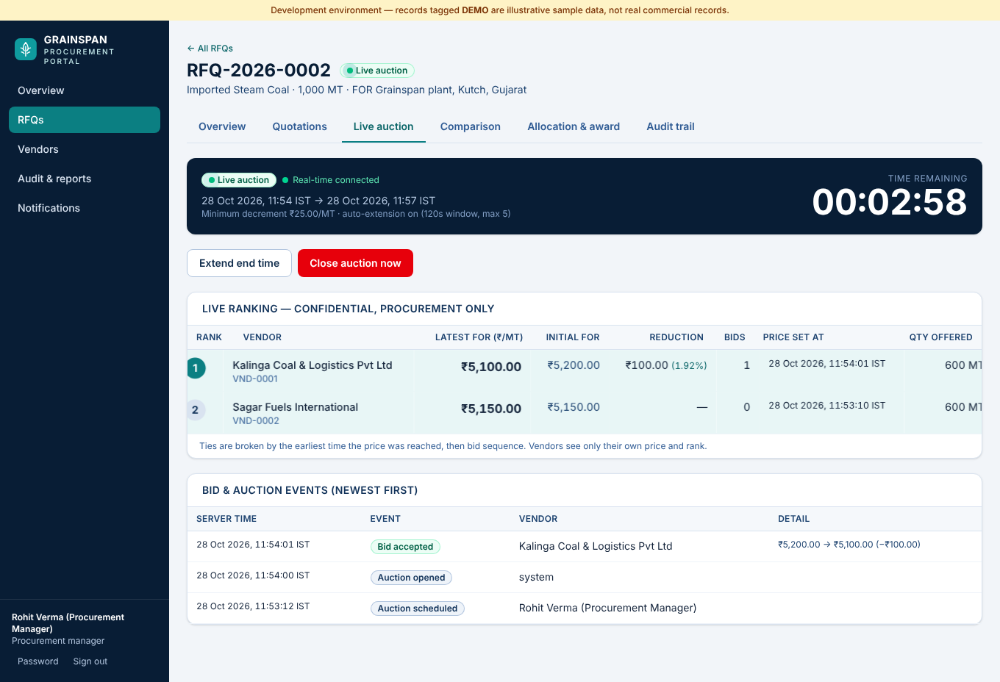
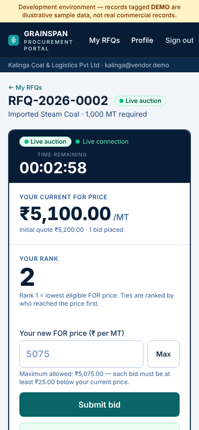
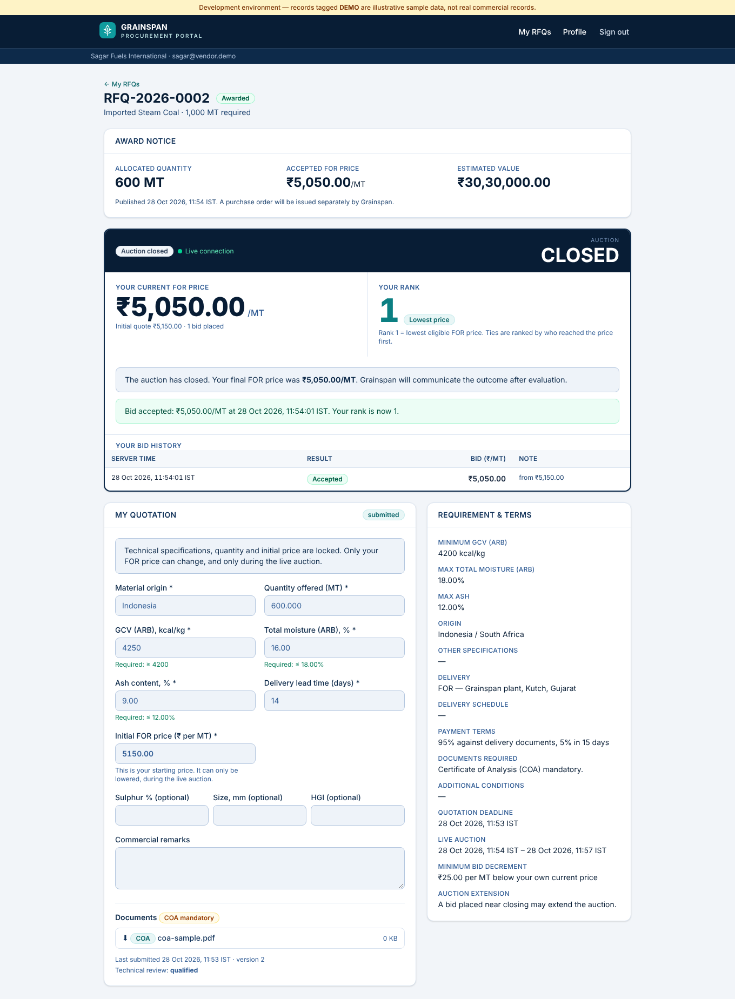

# Grainspan Procurement Portal

Live procurement and reverse-auction portal for **Grainspan Nutrients Private Limited** — coal RFQs, vendor quotations, technical qualification, **real-time multi-user reverse auctions**, bid comparison, manual quantity allocation with approvals, and a tamper-evident audit trail.

This is a working application (PostgreSQL + Next.js), not a mock-up. Two portals share one database:

* **Admin portal** (`/admin`) — Grainspan procurement team: RFQs, vendor approval, quotation review & qualification, live auction monitor, comparison matrix, allocation worksheet, award approval, audit log, notifications, exports.
* **Vendor portal** (`/vendor`) — each supplier has its own login and sees only RFQs it was invited to, its own quotation, its own FOR price and rank, and its own award.


<p align="center"> &nbsp; </p>

---

## Status — what is verified and what is not

| Area | Status | Evidence |
|---|---|---|
| Persistent PostgreSQL schema, migrations, seed | ✅ working | `db/migrations/001–005`, `npm run db:migrate` |
| Auth (vendor registration, login, sessions, lockout, password change/reset) | ✅ working | API tests |
| Admin / vendor separation + Row Level Security | ✅ working | 8 RLS tests + HTTP role tests |
| RFQ lifecycle, quotations, COA upload, qualification | ✅ working | DB + API tests, browser test |
| **Live auction engine** (server clock, atomic bids, ranking, extension, idempotency) | ✅ working | 15 DB tests incl. 40 concurrent bids; HTTP concurrency test |
| **Real-time updates across independent sessions** | ✅ working | Browser test: 4 separate Chromium contexts; competitor's rank updates in ≈ 0.2–0.3 s **without refresh** |
| Comparison matrix, CSV/Excel export | ✅ working | API test |
| Manual allocation, approval workflow, separation of duties | ✅ working | DB + API + browser tests |
| Audit trail (hash-chained, append-only) | ✅ working | tamper/deletion detection test |
| E-mail (Resend) and WhatsApp (Meta Cloud API): integration code, outbox, retries, delivery webhooks | ⚠️ **not exercised against the real services** | No provider credentials were available. The code is tested against local mock provider servers that verify request shape, auth headers, idempotency keys, retry/backoff and webhook signatures. Setup checklist: [docs/NOTIFICATIONS.md](docs/NOTIFICATIONS.md) |
| Public HTTPS deployment | ❌ **not deployed** | No hosting/Supabase credentials were available. Instructions, Dockerfile and compose stack: [docs/DEPLOYMENT.md](docs/DEPLOYMENT.md). The production entry point (`node .next/standalone/server.js`) was run and health-checked locally; the Docker image itself was not built (no Docker daemon in the build sandbox). |
| Supabase Auth / Realtime / Storage | ❌ **not used** | See [Design decisions](#design-decisions). The schema is plain PostgreSQL (≥ 15) and is intended to run on Supabase's database, but it has **not been run on Supabase** — see the notes in [docs/DEPLOYMENT.md](docs/DEPLOYMENT.md). |

**Test totals (all run against real PostgreSQL 16 and the real built server):** 50 database tests · 27 HTTP tests · 1 browser acceptance test (≈ 60 assertions). Details and limits: [docs/TESTING.md](docs/TESTING.md).

---

## Quick start (local)

Requirements: Node 20+ (22 tested), PostgreSQL 15+ (a helper starts a local one without Docker), Chromium only for the browser test.

```bash
npm install
npm run db:start                 # local PostgreSQL on :54329 (scripts/dev-db.sh) — or point .env at any PostgreSQL
cp .env.example .env             # defaults match db:start; set SESSION_SECRET (openssl rand -hex 32)
createdb -h 127.0.0.1 -p 54329 -U postgres grainspan
npm run db:migrate               # applies db/migrations, creates the restricted `grainspan_app` role
npm run db:seed                  # DEMO data (clearly tagged "DEMO" in the UI and watermarked in exports)
npm run dev                      # http://localhost:3000
```

Demo accounts (password `Demo@12345`, development only — the seed refuses to run in production):

| Role | Login |
|---|---|
| Administrator | `admin@grainspan.demo` |
| Procurement manager | `manager@grainspan.demo` |
| Approver | `approver@grainspan.demo` |
| Vendors (approved) | `kalinga@vendor.demo`, `sagar@vendor.demo`, `bharat@vendor.demo`, `coastal@vendor.demo` |
| Vendor awaiting approval | `pending@vendor.demo` |

The seed creates one DEMO RFQ in the quotation phase with **no bids**; demo and real commercial data are never mixed (`is_demo` flag on vendors and RFQs, DEMO badges in the UI, watermark in exports).

Run the tests:

```bash
npm run typecheck
npm test                         # 50 database-level tests (creates a throw-away grainspan_test database)
npm run build && npm run test:api    # 27 HTTP-level tests (boots a fresh DB + the real server + mock e-mail/WhatsApp providers)
npm run test:e2e                 # browser acceptance test: admin + approver + 2 vendors in separate Chromium contexts (~90 s)
```

---

## Architecture

```
 Browser (React, Tailwind)                      Next.js 16 server (single Node process)               PostgreSQL 15+
 ┌──────────────────────┐   HTTPS / JSON        ┌───────────────────────────────────────┐   pg   ┌─────────────────────────┐
 │ Admin portal         │ ───────────────────▶  │ Route handlers  (zod validation,      │ ─────▶ │ role: grainspan_app     │
 │ Vendor portal        │ ◀───────────────────  │  session auth, CSRF origin check,     │        │  (no superuser, no      │
 │                      │   SSE (EventSource)   │  rate limits)                         │        │   BYPASSRLS)            │
 │  live auction pages  │ ◀═══════════════════  │ Services  → withUser(userId, tx)      │        │                         │
 └──────────────────────┘   role-filtered       │ Scheduler  (open/close/reminders)     │        │ RLS policies            │
                            snapshots           │ Notification dispatcher (outbox)      │        │ place_bid()  (atomic)   │
                                                │ LISTEN hub  ◀── pg_notify ────────────┼───────▶│ audit chain, triggers   │
                                                └──────────────┬────────────────────────┘        └─────────────────────────┘
                                                               │ HTTPS
                                                      Resend (e-mail) · WhatsApp Cloud API
```

* **All business invariants live in the database** — state machines, qualification locks, allocation limits, separation of duties, append-only tables and the bid function are triggers/functions, so a bug (or a second client) in the application layer cannot violate them. TypeScript services add friendly validation and orchestration.
* **Row Level Security is the authorisation backbone.** The server connects as the restricted `grainspan_app` role and, per request, sets transaction-local `app.mode` / `app.user_id` *after* authenticating the session. Policies and `SECURITY DEFINER` functions read those. No context ⇒ no rows (fail-closed).
* **Vendors never touch the bid, auction or event tables.** They read only through three functions that can return nothing but the caller's own data: `vendor_auction_state`, `vendor_bid_history`, `vendor_award_result`.
* **Realtime** = Postgres `NOTIFY` (fired at COMMIT by `place_bid` and by lifecycle/status triggers) → one `LISTEN` connection per server process → Server-Sent Events. A notification carries ids only; each open page then receives a freshly computed snapshot **for its own role** (staff: full ranking; vendor: own price/rank only).

### File structure

```
db/migrations/        001 schema · 002 security & integrity triggers · 003 auction engine + RLS + grants · 004/005 adjustments
scripts/              migrate · seed (DEMO) · create-admin (production bootstrap) · dev-db.sh (local Postgres)
src/lib/              db (contexts) · auth/ · http (api wrapper) · validation (zod) · scheduler · realtime/hub · reports (CSV/XLSX)
src/lib/services/     rfqs · offers (+documents) · auctions · auction-lifecycle · allocations · vendors · snapshot
src/lib/notify/       templates · email (Resend) · whatsapp (Cloud API) · enqueue (outbox) · dispatcher (retry/backoff)
src/app/api/          50 route handlers (auth, rfqs, auctions/bids, offers, vendors, audit, notifications, webhooks, cron, health)
src/app/admin/        dashboard · rfqs/[id] (overview · quotations · live auction · comparison · allocation · audit) · vendors · audit · notifications · users
src/app/vendor/       RFQ list · RFQ page (quotation, documents, live bidding, award) · profile · register
tests/                db/ (50) · api/ (27) · e2e/ (browser) · helpers/
Dockerfile · docker-compose.yml · deploy/Caddyfile · docs/
```

---

## Auction rules (as implemented — all enforced inside `place_bid()` in PostgreSQL)

* **Eligibility:** invited + approved vendor + *submitted* quotation + technically **qualified**. Anyone else gets a generic `NOT_ELIGIBLE` (no information about whether the auction exists).
* **Clock:** only the database server clock (`clock_timestamp()` read *after* the auction row lock is taken). Open/close times are server-controlled; the browser countdown is display-only. A late bid is rejected even if the scheduler has not yet flipped the status.
* **Price rule:** every bid must be at least the RFQ's minimum decrement **below the vendor's own current accepted price** (the vendor's initial FOR quotation counts as the starting price). Upward, equal, non-positive or >2-decimal bids are rejected. Only the FOR price changes during the auction.
* **Concurrency:** `SELECT … FOR UPDATE` on the auction row serialises all bids of one auction. Tested with 40 simultaneous bids.
* **Idempotency:** each submission carries a client-generated key, unique per (auction, vendor). A network retry returns the original bid instead of failing or double-applying.
* **Immutability:** accepted bids go into an append-only table (UPDATE/DELETE/TRUNCATE are rejected by triggers, even for the owner; the app role has no write privilege at all). Rejections are recorded as auction events.
* **Ranking:** Rank 1 = lowest price among qualified vendors. **Tie-break:** the vendor who reached that price first (bid `accepted_at`, or quotation submission time for an unrevised initial price), then lower bid sequence number, then vendor id → ranks are always a unique, deterministic permutation.
* **Extension (optional per RFQ):** if a bid lands within *N* seconds of the end, the end moves to *now + M* seconds, up to a maximum number of times; every extension is an auditable event.
* **Visibility:** vendors see only their own price, own rank, countdown/status and own history. Admins see all prices, ranks, history, rejections.
* **Technical vs commercial:** qualification is a separate gate. Lowest price never creates an award — awards are manual allocations that go through submission → approval → publication.

## Roles

| Capability | Admin | Procurement manager | Approver | Vendor |
|---|:-:|:-:|:-:|:-:|
| Create/publish/cancel RFQs, schedule & control auctions | ✅ | ✅ | – | – |
| Approve vendor registrations, qualify quotations | ✅ | ✅ | – | – |
| View rankings, matrix, audit log, exports | ✅ | ✅ | ✅ (read-only) | – |
| Edit / submit allocation | ✅ | ✅ | – | – |
| Approve / reject / publish award | ✅ | – | ✅ | – |
| Manage staff users, reopen a *live* auction to qualification | ✅ | – | – | – |
| Quote, upload COA, bid, see own award | – | – | – | ✅ (own data only) |

The person who submits an award can never approve it (enforced in the database, including for administrators).

## RFQ states

`draft → published → quotation_open → qualification → scheduled → live → closed → awarded` (and `cancelled` from any non-terminal state). Transitions are enforced by a database trigger; specifications freeze at publication; quotations lock when the quotation window closes; reopening qualification cancels the auction (its bids are preserved) and lets the admin grant per-vendor revisions.

## Configuration

All configuration is via environment variables — see [`.env.example`](.env.example) (every variable is documented there). Secrets stay server-side; nothing privileged is exposed to the browser (`NEXT_PUBLIC_APP_TIMEZONE` is the only public variable). The runtime database role cannot bypass RLS.

## Documentation

* [docs/DEPLOYMENT.md](docs/DEPLOYMENT.md) — public HTTPS deployment (Docker/Caddy, managed Postgres incl. Supabase), backup & recovery, production launch checklist
* [docs/NOTIFICATIONS.md](docs/NOTIFICATIONS.md) — Resend + WhatsApp setup checklist, template wording for Meta approval, status model, webhooks
* [docs/SECURITY.md](docs/SECURITY.md) — controls, where each is enforced and tested, known limitations
* [docs/TESTING.md](docs/TESTING.md) — test inventory, results, what the tests do **not** prove

## Design decisions

* **PostgreSQL directly instead of Supabase Auth / Realtime / Storage.** The build environment could not reach or provision Supabase, and I will not claim an integration I cannot run. The schema is plain PostgreSQL (≥ 15), written so it can run on Supabase's database, but it has only been run on a local PostgreSQL 16. Authentication is a small server-side session system (scrypt hashes, hashed session tokens, lockout, idle/absolute timeouts); realtime is SSE over `LISTEN/NOTIFY`; documents are stored in a private Postgres table (≤ 10 MB, content-sniffed, served only through an authenticated route). Swapping Supabase Auth in is a contained change in `src/lib/auth/` plus mapping `auth.users` to `profiles`.
* **Long-running Node host, not serverless.** SSE and the in-process scheduler need a persistent process (Docker, Fly, Render, Railway, a VPS). Vercel's serverless functions are not suitable as-is; see [docs/DEPLOYMENT.md](docs/DEPLOYMENT.md).
* **No purchase-order integration** — by requirement. Publishing an award only informs vendors.

## Known limitations

See [docs/SECURITY.md](docs/SECURITY.md#known-limitations) for the full list. Highlights: no MFA, no antivirus scanning of uploads, in-memory rate limiting (single instance), notification providers untested against live services, deployed only on paper until you run the checklist.
